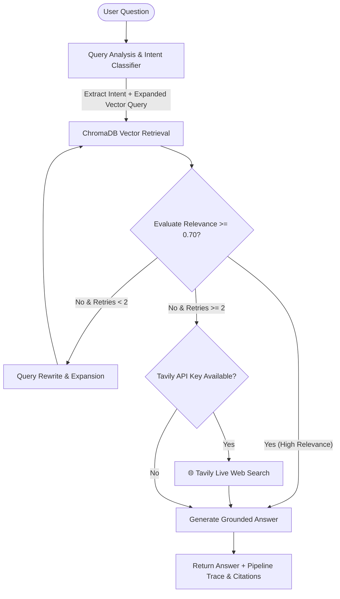

# 🧠 Self-Corrective RAG Document Assistant with Groq LPU & LangGraph

[](https://python.org)
[](https://fastapi.tiangolo.com)
[](https://langchain-ai.github.io/langgraph/)
[](https://groq.com)
[](https://react.dev)
[](https://www.typescriptlang.org/)
[](https://www.docker.com)

A production-grade, containerized monorepo implementing an enterprise **Self-Corrective Retrieval-Augmented Generation (Corrective RAG / CRAG)** pipeline. Powered by **Groq Cloud's LPU inference engine**, **LangGraph cyclic state machines**, **ChromaDB vector store**, and a modern **React 18 + TypeScript** dashboard with an interactive **Explainability & Pipeline Trace Drawer**.

---

## 📑 Table of Contents
- [🌟 Key Highlights & Capabilities](#-key-highlights--capabilities)
- [🏗️ Architectural Workflow](#️-architectural-workflow)
- [🔍 Full Pipeline Explainability](#-full-pipeline-explainability)
- [📁 Project Directory Structure](#-project-directory-structure)
- [🚀 Quick Start (Docker)](#-quick-start-docker)
- [⚙️ Configuration & Environment Variables](#️-configuration--environment-variables)
- [📡 API Documentation](#-api-documentation)
- [🧪 Running Automated Tests](#-running-automated-tests)
- [🛡️ Security & Privacy](#️-security--privacy)

---

## 🌟 Key Highlights & Capabilities

### 1. ⚡ Ultra-Fast Groq LPU Inference
- Uses **GroqCloud** high-throughput LPU hardware (`openai/gpt-oss-120b` or `llama-3.3-70b-versatile`) to deliver sub-second query rewrites, document grading, and structured answer synthesis.
- Flexible multi-provider support: switch effortlessly between **Groq**, **Grok (xAI)**, or **OpenAI** via environment variables.

### 2. 🎯 Intent-Aware Semantic Analysis
- Categorizes user prompts into distinct operational intents:
  - `Conceptual Guide`: In-depth breakdown of fundamental principles and mechanisms.
  - `Code Implementation`: Runnable, copy-ready code snippets with line-by-line explanations.
  - `Comparison Matrix`: Markdown tables highlighting trade-offs and differences.
  - `Troubleshooting / Debugging`: Problem-solution root-cause diagnosis.
- Shapes the downstream generation prompt to directly match the user's intent.

### 3. 🔄 Self-Corrective RAG (CRAG) with Auto-Retry
- **Document Grading Node**: Every chunk retrieved from ChromaDB is evaluated by the LLM for relevance against the question.
- **Relevance Confidence Scoring**: Calculates a real-time similarity score (`0.0 - 1.0`). If chunks score below the threshold (`0.70`), the query analysis node triggers a rewrite loop with expanded keywords (up to 2 retries).

### 4. 🌐 Real-Time Web Search Fallback (Tavily API)
- When questions cannot be answered by local documentation, the agent automatically switches to **Tavily Web Search** to retrieve up-to-date web information rather than hallucinating.

### 5. 🎨 Explainable & Transparent Frontend
- **Pipeline Trace Drawer**: A collapsible diagnostic accordion under each answer displaying:
  - Understood User Intent badge
  - Execution Routing Path (ChromaDB / Tavily Web Search / Direct Knowledge)
  - Calculated Relevance Confidence Score (e.g. `Score: 75%`)
  - The exact expanded vector search query used by ChromaDB
- **Rich Markdown Viewer**: Zero-dependency renderer with syntax-styled code blocks, 1-click clipboard copy, zebra-striped comparison tables, and highlight callouts.
- **Prompt Suggestion Chips**: Quick-start pills for immediate 1-click testing across diverse query intents.

### 6. 📄 Multi-Format Ingestion Engine
- Ingests both **Markdown (`.md`)** technical guides and **PDF documents (`.pdf`)** via `pypdf`.
- Splits content using recursive token chunking with configurable overlap.

---

## 🏗️ Architectural Workflow

The system is governed by a **LangGraph stateful cyclic graph**:



### LangGraph Workflow Nodes:
1. **`query_analysis_node`**: Analyzes the raw question, identifies user intent, and expands the query with domain synonyms.
2. **`retrieval_node`**: Queries ChromaDB vector collection using cosine similarity.
3. **`grade_documents_node`**: Filters chunks and computes an aggregate relevance score.
4. **`generation_node`**: Injects grounded citations and formats markdown according to the identified intent.

---

## 🔍 Full Pipeline Explainability

Unlike black-box chat interfaces, this assistant renders a full audit trace for every response:

```
┌────────────────────────────────────────────────────────────────────────┐
│ ⚡ Pipeline Trace & Explainability               [Intent: Conceptual Guide] │
├────────────────────────────────────────────────────────────────────────┤
│ Understood User Intent: Conceptual Guide                               │
│ Execution Path:         📁 ChromaDB Vector Knowledge Store (Score: 75%)│
│ Search Query Used:      Java polymorphism definition types compile-time │
│                         runtime method overriding overloading examples │
└────────────────────────────────────────────────────────────────────────┘
```

---

## 📁 Project Directory Structure

```text
rag-doc-assistant/
├── backend/
│   ├── app/
│   │   ├── core/              # Dependency injection container & LLM Factory
│   │   │   ├── container.py
│   │   │   └── llm_factory.py # GroqCloud, Grok xAI, and OpenAI clients
│   │   ├── domain/            # Domain entities and typing protocols
│   │   ├── ingestion/         # Document loaders (PDF & Markdown), chunker, vector store
│   │   │   ├── chunker.py
│   │   │   ├── loaders.py     # pypdf + text loaders
│   │   │   └── vector_store.py# ChromaDB integration
│   │   ├── storage/           # SQLite / JSON repositories for feedback
│   │   ├── workflow/          # LangGraph state machine & prompts
│   │   │   ├── graph.py       # Graph definition & edge conditions
│   │   │   ├── nodes.py       # Query analysis, retrieval, grading, generation
│   │   │   ├── prompts.py     # Intent & generation prompt templates
│   │   │   └── state.py       # TypedDict graph state
│   │   ├── config.py          # Pydantic v2 application settings
│   │   ├── main.py            # FastAPI application routes
│   │   └── schemas.py         # Request/response validation schemas
│   ├── data/
│   │   ├── chroma/            # Persistent vector database
│   │   └── sample_docs/       # Bundled sample technical documentation
│   ├── tests/                 # Integration and unit test suite
│   ├── Dockerfile             # Multi-stage Python 3.11 container
│   ├── requirements.txt       # Backend dependencies
│   └── pytest.ini             # Test runner configuration
├── frontend/
│   ├── src/
│   │   ├── api/               # API client (submitQuery, fetchDocuments, feedback)
│   │   ├── components/        # MarkdownView custom renderer
│   │   ├── types/             # TypeScript API interfaces
│   │   ├── App.tsx            # Main chat interface & Explainability Drawer
│   │   └── main.tsx           # React entry point
│   ├── nginx.conf             # Production Nginx reverse proxy
│   ├── Dockerfile             # Multi-stage Node.js build + Nginx Alpine
│   └── package.json           # Frontend dependencies
├── docker-compose.yml         # Container orchestration
├── .env.example               # Sanitized environment template
└── README.md                  # System documentation
```

---

## 🚀 Quick Start (Docker)

### Prerequisites
- [Docker](https://docs.docker.com/get-docker/) & Docker Compose installed.
- A free [GroqCloud API Key](https://console.groq.com/).

### 1. Clone the Repository
```bash
git clone https://github.com/URK21CS2040/rag-doc-assistant.git
cd rag-doc-assistant
```

### 2. Configure Environment Variables
Copy `.env.example` to `.env` and add your Groq API key:
```bash
cp .env.example .env
```
Edit `.env`:
```env
LLM_PROVIDER=groq
GROQ_API_KEY=gsk_your_groq_api_key_here
GROQ_MODEL=openai/gpt-oss-120b

# Optional: Add Tavily API key for live web search fallback
TAVILY_API_KEY=tvly-your_key_here
```

### 3. Launch with Docker Compose
```bash
docker compose up --build -d
```

### 4. Open in Browser
- **Frontend Dashboard**: [http://localhost](http://localhost)
- **Interactive Swagger API Docs**: [http://localhost:8000/docs](http://localhost:8000/docs)
- **OpenAPI JSON Spec**: [http://localhost:8000/openapi.json](http://localhost:8000/openapi.json)

---

## ⚙️ Configuration & Environment Variables

| Variable | Default Value | Description |
| :--- | :--- | :--- |
| `LLM_PROVIDER` | `groq` | Primary LLM provider (`groq`, `grok`, or `openai`). |
| `GROQ_API_KEY` | `""` | GroqCloud API Key (Get from [console.groq.com](https://console.groq.com)). |
| `GROQ_MODEL` | `openai/gpt-oss-120b` | Target Groq model (e.g. `openai/gpt-oss-120b`, `llama-3.3-70b-versatile`). |
| `GROQ_BASE_URL` | `https://api.groq.com/openai/v1` | Groq OpenAI-compatible API base URL. |
| `TAVILY_API_KEY` | `""` | *(Optional)* Tavily Search API key for automatic web fallback. |
| `CHROMA_PERSIST_DIRECTORY` | `/app/data/chroma` | Path where ChromaDB vectors are stored. |
| `PORT` | `8000` | Port for the backend FastAPI server. |
| `ANONYMIZED_TELEMETRY` | `False` | Disables ChromaDB analytics telemetry. |

---

## 📡 API Documentation

### 1. `POST /api/query`
Submit a question to the self-corrective RAG workflow.

**Request Body:**
```json
{
  "question": "Explain inheritance in Java with code",
  "session_id": "session-123"
}
```

**Response Body:**
```json
{
  "answer": "### Inheritance in Java\n\nInheritance allows a subclass to inherit attributes and methods...",
  "sources": [
    {
      "document_id": "/app/data/sample_docs/java_oop_concepts.md",
      "chunk_text": "## 2. Inheritance\nInheritance allows a new class...",
      "score": 0.75
    }
  ],
  "retries": 0,
  "relevance_score": 0.75,
  "query_intent": "Conceptual Guide",
  "rewritten_query": "Java inheritance explanation code examples extends super subclass OOP"
}
```

---

### 2. `GET /api/documents`
Lists all documents currently indexed in ChromaDB.

---

### 3. `POST /api/documents/upload`
Upload a new `.pdf` or `.md` file to be chunked and indexed dynamically.

---

### 4. `POST /api/feedback`
Submits user feedback (`thumbs_up` / `thumbs_down` + optional comment) for quality tracking.

---

## 🧪 Running Automated Tests

The test suite covers API integration, document chunking, PDF/Markdown loading, and LangGraph workflow routing:

```bash
docker exec rag_backend pytest -v
```

**Output:**
```text
tests/integration/test_api_endpoints.py::test_list_documents PASSED          [ 16%]
tests/integration/test_api_endpoints.py::test_feedback_endpoint PASSED       [ 33%]
tests/unit/test_chunker_and_loaders.py::test_text_chunker PASSED             [ 50%]
tests/unit/test_llm_factory.py::test_llm_factory_groq PASSED                 [ 66%]
tests/unit/test_llm_factory.py::test_local_hash_embeddings PASSED            [ 83%]
tests/unit/test_workflow_nodes_and_routing.py::test_graph_state_init PASSED   [100%]

============================== 6 passed in 0.72s ===============================
```

---

## 🛡️ Security & Privacy

- **Safe Secret Handling**: `.gitignore` strictly blocks all `.env` files, secrets, database persistence caches, and build folders from ever touching Git.
- **Safe Docker Execution**: Non-root container operation where applicable.
- **Zero Telemetry**: `ANONYMIZED_TELEMETRY=False` ensures your indexed documents are not shared with third-party tracking services.

---

## 📄 License
This project is open-source and available under the [MIT License](LICENSE).
